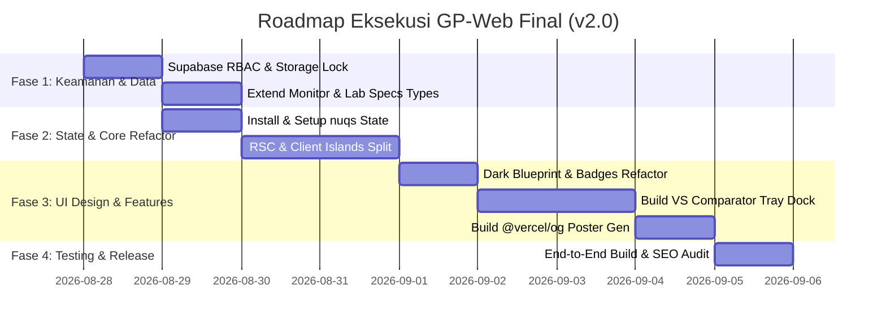

# 📝 DOKUMEN BRAINSTORM & AUDIT SISTEM: GRAYPLASMA WEB (GP-WEB)
*Dokumen Arsitektur Sistem, Audit Keamanan, Kaidah Desain Minimalis, Fitur Lab GTID & Roadmap Finalisasi*
*Versi: 2.0.0 (Enhanced Architecture & Security Edition) — Tanggal: 28 Agustus 2026*
*Target Brand: GrayPlasma ID (@gray1plasma) x GTID Tech Lab*

---

## DAFTAR ISI
1. [Filosofi & DNA Desain GrayPlasma (Visual Identity)](#1-filosofi--dna-desain-grayplasma-visual-identity)
2. [Audit Total Sistem & Analisis Celah Keamanan (Hardened RBAC Fix)](#2-audit-total-sistem--analisis-celah-keamanan-hardened-rbac-fix)
3. [Arsitektur Performa: RSC Islands, nuqs & Conflict Resolution](#3-arsitektur-performa-rsc-islands-nuqs--conflict-resolution)
4. [Spesifikasi Sistem Desain: Dark Blueprint & Anti-Flashbang System](#4-spesifikasi-sistem-desain-dark-blueprint--anti-flashbang-system)
5. [Spesifikasi Data Display Modern GTID Tech Lab](#5-spesifikasi-data-display-modern-gtid-tech-lab)
6. [Fitur Unggulan Baru: VS Comparator & Dynamic Infographic Generator](#6-fitur-unggulan-baru-vs-comparator--dynamic-infographic-generator)
7. [Walkthrough Blueprint Komponen UI & Wireframes](#7-walkthrough-blueprint-komponen-ui--wireframes)
8. [Script Database Supabase & Kebijakan Keamanan RBAC](#8-script-database-supabase--kebijakan-keamanan-rbac)
9. [Roadmap Eksekusi Finalisasi Produksi](#9-roadmap-eksekusi-finalisasi-produksi)

---

## 1. FILOSOFI & DNA DESAIN GRAYPLASMA (VISUAL IDENTITY)

Berdasarkan analisis infografis ulasan monitor (*Lenovo Legion 27Q-10* dan *1ms Response Time Gimmick Carousel*), brand GrayPlasma memiliki karakter **Minimalist Tech-Editorial & Data Infographic**. Pendekatan desain ini membedakan GP-Web dari situs review monitor biasa:

```
┌─────────────────────────────────────────────────────────────────────────────┐
│                    GRAYPLASMA DESIGN IDENTITY SYSTEM                        │
├───────────────────────┬─────────────────────────────┬───────────────────────┤
│    TIPE AESTHETIC     │      PALET WARNA UTAMA      │      TYPOGRAPHY       │
│  Minimalist Tech-     │  Dark Blueprint (#09090B)   │   Metropolitan /      │
│  Editorial & Data     │  GP Neon Orange (#FF5722)   │   Montserrat          │
│  Infographic Grid     │  GP Electric Blue (#0088FF) │   Strict Weight       │
│                       │  GP Crimson Red (#FF2D55)   │   (400, 600, 800)     │
│                       │  GP Acid Green (#00E676)    │   Tabular Numerals    │
│                       │  Technical Grid (#12131A)   │                       │
└───────────────────────┴─────────────────────────────┴───────────────────────┘
```

### 5 Pilar Visual Utama:
1. **Dualitas Background & Anti-Flashbang Solution:**
   - **OLED Dark Blueprint (`#09090B` / `#0D0D11`):** Digunakan untuk Navbar, Hero Banner, Katalog Utama, dan Card Monitor dengan aksen garis grid teknikal.
   - **Dark Technical Blueprint Sheet (`#12131A` dengan grid `#222433`):** Menggantikan kertas putih terang di dalam Dark Mode agar mata tidak terkena *flashbang*, dilengkapi aksen font monospaced cyan dan neon amber.
   - **Technical Light Graph Paper (`#F8F9FA`):** Dikhususkan untuk mode ekspor poster infografis PNG atau saat global light mode diaktifkan.
2. **Pill Spec Badges (Kapsul Metrik):**
   - Spesifikasi kunci tidak disajikan dalam teks biasa, melainkan berbentuk kapsul bordered dengan tipografi tebal (contoh: `[ 27 INCH ]`, `[ 2560 × 1440 QHD ]`, `[ 240 HZ* ]`, `[ 8 BITS ]`, `[ 100 × 100 MM ]`).
3. **Data Matrix Lab (Klaim Marketing vs Realita Lab GTID):**
   - Menampilkan tabel komparasi tajam antara klaim pabrikan (0.5ms MPRT, HDR 400) melawan hasil tes sensor lab asli (5.2ms GtG Toleransi 5 RGB, 270 nits SDR, Overshoot %, Subpixel Layout).
4. **Side Ribbon Indicators:**
   - Ribbon vertikal kontras tinggi di tepi kartu/panel drawer:
     - `PROS ++++` (Aksen Hijau Neon / `#00E676`)
     - `CONS ----` (Aksen Merah Crimson / `#FF2D55`)
     - Ribbon Ticker Model di tepi kanan kartu.
5. **Metropolitan Typography Strict Rules:**
   - Font geometris sans-serif (Metropolitan / Montserrat) dengan kerning rapi.
   - Angka metrik teknis wajib menggunakan format monospaced/tabular-nums.
   - Batas maksimal ketebalan font: Extra Bold (800) untuk menjaga kesan minimalis elegan, tidak bulky.

---

## 2. AUDIT TOTAL SISTEM & ANALISIS CELAH KEAMANAN (HARDENED RBAC FIX)

```mermaid
graph TD
    Client[Browser Client / User Umum] -->|Anon Key Public| Supabase[(Supabase DB)]
    AdminUser[Admin GrayPlasma] -->|JWT with app_metadata.role = admin| Supabase
    Client -->|SELECT Query (Public)| ReadAllowed[✅ BACA KATALOG DIIZINKAN]
    Client -->|DELETE/UPDATE Query| SecurityBlocked[🛑 DITOLAK RLS RBAC]
    AdminUser -->|INSERT/UPDATE/DELETE| AdminAllowed[✅ AKSES ADMIN DIIZINKAN]
```

### A. Celah Keamanan Fatal: Blanket `authenticated` Role
* **Masalah:** Jika RLS ditulis `FOR ALL TO authenticated USING (true)`, maka setiap pengguna yang login (misal login via Discord untuk fitur bookmark / komentar) otomatis memiliki hak mengubah atau menghapus katalog monitor.
* **Perbaikan Wajib (RBAC via JWT Claims):**
  ```sql
  CREATE POLICY "Admin Full Access Monitors" ON public.monitors 
    FOR ALL TO authenticated 
    USING ( (auth.jwt() -> 'app_metadata' ->> 'role') = 'admin' )
    WITH CHECK ( (auth.jwt() -> 'app_metadata' ->> 'role') = 'admin' );
  ```

---

## 3. ARSITEKTUR PERFORMA: RSC ISLANDS, NUQS & CONFLICT RESOLUTION

### A. URL Search Params State Management Menggunakan `nuqs`
Menghilangkan boilerplate `useSearchParams + useRouter` di Next.js App Router yang sering memicu re-render atau isu Suspense boundary. `nuqs` memberikan type-safe URL synchronization:
```ts
// Hook filter berbasis nuqs
import { useQueryState, parseAsString, parseAsArrayOf, parseAsInteger } from "nuqs";

export function useMonitorFilters() {
  const [tab, setTab] = useQueryState("tab", parseAsString.withDefault("all"));
  const [resolutions, setResolutions] = useQueryState("res", parseAsArrayOf(parseAsString).withDefault([]));
  const [tiers, setTiers] = useQueryState("tier", parseAsArrayOf(parseAsString).withDefault([]));
  const [maxBudget, setMaxBudget] = useQueryState("budget", parseAsInteger.withDefault(25000000));
  const [compareList, setCompareList] = useQueryState("compare", parseAsArrayOf(parseAsString).withDefault([]));

  return { tab, setTab, resolutions, setResolutions, tiers, setTiers, maxBudget, setMaxBudget, compareList, setCompareList };
}
```

### B. Pemisahan React Server Components (RSC) & Client Islands
```
┌─────────────────────────────────────────────────────────────────────────────┐
│ 1. SERVER COMPONENT ROOT (/app/page.tsx & /app/monitor/[slug]/page.tsx)     │
│    - Mengambil data katalog awal secara SSR / SSG / ISR (Kencang & SEO-Ready)│
│    - Metadata OpenGraph dinamis ke-generate di server                       │
├─────────────────────────────────────────────────────────────────────────────┤
│ 2. CLIENT ISLANDS (Hanya membungkus bagian yang interaktif)                │
│    - <CatalogFilterIsland /> : Menangani search bar & query tabs via nuqs   │
│    - <CatalogGridIsland />   : Merender grid & animasi kartu monitor         │
│    - <SidePeekDrawerIsland />: Menangani preview detail & gallery foto      │
│    - <ComparatorTrayIsland />: Floating compare dock di bagian bawah layar  │
└─────────────────────────────────────────────────────────────────────────────┘
```

### C. Optimistic Locking & Conflict Resolution (Dual-Source Sync)
Setiap record monitor ditambahkan field `updated_at: TIMESTAMPTZ` dan `version_id: INT`.
- Saat data disimpan:
  $$\text{Jika } \text{local.updated\_at} < \text{remote.updated\_at} \implies \text{Peringatan Konflik Sinkronisasi (Munculkan Dialog Perbandingan)}$$

---

## 4. SPESIFIKASI SISTEM DESAIN: DARK BLUEPRINT & ANTI-FLASHBANG SYSTEM

### A. Palet Token Warna (Tailwind & CSS Tokens)
```css
:root {
  /* Surface & Background */
  --gp-bg-dark: #09090b;          /* OLED Deep Black */
  --gp-surface-dark: #111115;     /* Panel Dark Surface */
  --gp-surface-elevated: #18181f; /* Card Elevated Background */
  --gp-border-subtle: #27272a;    /* Hairline Border */
  --gp-border-glow: #3f3f46;      /* Active Border */

  /* Dark Technical Blueprint Sheet (Anti-Flashbang) */
  --gp-blueprint-dark: #12131a;   /* Blueprint Sheet Background */
  --gp-blueprint-grid: #1f202b;   /* Subtle Blueprint Grid */
  --gp-blueprint-cyan: #00d2ff;   /* Blueprint Dimension Accent */

  /* Light Editorial Graph Paper (Export Mode Only) */
  --gp-paper-bg: #f8f9fa;         /* Light Editorial Sheet */
  --gp-paper-grid: #e5e7eb;       /* Graph Grid Lines */
  --gp-paper-text: #18181b;       /* Pure Dark Ink */

  /* Brand Accents */
  --gp-orange: #ff5722;           /* GP Hero Accent */
  --gp-orange-glow: rgba(255, 87, 34, 0.25);
  --gp-blue: #0088ff;             /* GP Tech Blue */
  --gp-emerald: #00e676;          /* Pros / S-Tier Green */
  --gp-crimson: #ff2d55;          /* Cons / Gimmick Red */
  --gp-amber: #ffb300;            /* Realita / Tolerance Amber */
}
```

---

## 5. SPESIFIKASI DATA DISPLAY MODERN GTID TECH LAB

Untuk memenuhi standar pengujian monitor modern, skema data ditambahkan 4 metrik spesifikasi krusial:

1. **Overshoot / Inverse Ghosting (%):**
   - Menghitung persentase overshoot pada level overdrive yang disarankan agar visual tidak berbayang putih (misal: `< 5% (Overdrive Level Normal)` vs `> 25% (Overdrive Extreme - Hindari)`).
2. **Sub-pixel Layout:**
   - `"RGB Stripe"` (Standar teks tajam di Windows)
   - `"BGR Stripe"` (Perlu ClearType tuning)
   - `"QD-OLED Gen 1 (Triangular)"` (Fringing pada teks tipis)
   - `"QD-OLED Gen 2/3"` (Teks jernih)
   - `"WOLED (RWBG)"` (Subpixel putih tambahan)
3. **VRR Range & LFC Support:**
   - Rentang refresh rate variabel aktif (contoh: `48Hz – 240Hz (DisplayPort)`, mendukung Low Framerate Compensation / LFC).
4. **Coating Type (Tipe Lapisan Layar):**
   - `"Matte 3H (Anti-Glare)"` — Cocok untuk ruangan terang dengan pantulan minimal.
   - `"Semi-Glossy (Low Haze)"` — Sweetspot kejernihan dan refleksi.
   - `"True Glossy"` — Kontras hitam pekat maksimal (OLED).

---

## 6. FITUR UNGGULAN BARU: VS COMPARATOR & DYNAMIC INFOGRAPHIC GENERATOR

### A. Side-by-Side Monitor Comparator (Floating Tray Dock)
* User dapat mengepin hingga 3 monitor dari kartu katalog (`+ VS`).
* Sebuah floating dock muncul di bagian bawah layar dengan thumbnail monitor yang dipilih.
* Klik "Bandingkan Spesifikasi & Data Lab" akan membuka modal komparasi head-to-head lengkap:
  - Komparasi Resolusi, Panel, Refresh Rate, & Response Time Lab (5 RGB).
  - Komparasi Subpixel, Coating, & Garansi Aftersales.
  - Pemenang setiap metrik ditandai dengan aksen emas/emerald otomatis.

### B. Dynamic OpenGraph & Social Infographic Generator (`@vercel/og`)
* Endpoint API: `/api/og/monitor?slug=[slug]&format=[square|banner]`
* Memanfaatkan Satori & ImageResponse untuk secara otomatis menghasilkan poster infografis beresolusi tinggi (1:1 untuk feed Instagram/Discord, 16:9 untuk Twitter/OG).
* Tombol **"Download Poster Infografis (PNG)"** di side-peek drawer memungkinkan admin atau pengunjung langsung menyimpan poster ulasan bergaya GrayPlasma dengan 1 klik.

---

## 7. WALKTHROUGH BLUEPRINT KOMPONEN UI & WIREFRAMES

### A. Card Rekomendasi Monitor Minimalis
```
┌─────────────────────────────────────────────────────────────────────────────┐
│ [ LENOVO ]                                                 [ 📌 + VS ] [ S ]│
│                                                                             │
│ ┌─────────────────────────────────────────────────────────────────────────┐ │
│ │                         [ GAMBAR MONITOR ]                              │ │
│ │                                                                         │ │
│ │ [⚡ 240Hz Fast IPS]  [🎨 100% DCI-P3]             [~1330:1 Deeper Black]│ │
│ └─────────────────────────────────────────────────────────────────────────┘ │
│                                                                             │
│ Lenovo Legion 27Q-10 (2K 240Hz Fast IPS)                                    │
│                                                                             │
│ [ 27 INCH ]  [ 2560×1440 QHD ]  [ 240 HZ ]  [ 8 BITS ]  [ MATTE 3H COATING ]│
│                                                                             │
│ ┌─────────────────────────────────────────────────────────────────────────┐ │
│ │ 🛡️ VERDICT GTID LAB: Motion clarity tajam, dE < 4, stand downgrade     │ │
│ └─────────────────────────────────────────────────────────────────────────┘ │
│                                                                             │
│ HARGA TERMURAH                                                              │
│ Rp 3.899.000  (Target Disarankan: Rp 3.750.000)                             │
│ ┌─────────────────────────────────────────────────────────────────────────┐ │
│ │ [ 🛒 Beli di Tokopedia Official ]        [ 🛍️ Shopee ]  [ 👁️ Quick View ]│ │
│ └─────────────────────────────────────────────────────────────────────────┘ │
└─────────────────────────────────────────────────────────────────────────────┘
```

### B. Dark Blueprint Verdict Box (Anti-Flashbang)
```
┌─────────────────────────────────────────────────────────────────────────────┐
│ ▒▒▒▒▒ DARK TECHNICAL BLUEPRINT SHEET (#12131A + GRID #1F202B) ▒▒▒▒▒▒▒▒▒▒▒▒▒ │
│                                                                             │
│ [ KESIMPULAN & VERDICT LAB ]                                  (GP WATERMARK)│
│                                                                             │
│ "SEBAIKNYA MENABUNG LAGI KE ASUS ROG XG27AQMES ATAU PILIH ALTERNATIF LAIN" │
│                                                                             │
│ Analisis Singkat:                                                           │
│ Meskipun tuning warna akurat dan response time 5.2ms sangat solid, batas    │
│ kecerahan 270 nits dan aftersales perlu diperhatikan pengguna.              │
│                                                                             │
│ ─────────────────────────────────────────────────────────────────────────── │
│ SUBPIXEL: RGB STRIPE (CLEAR TEXT)          COATING: MATTE 3H (ANTI-GLARE)   │
│ DATA UJI: LAB GTID TECH (TOLERANSI 5 RGB)  KURASI: @GRAY1PLASMA DIGITAL     │
│                                                                             │
│ [ 📥 EXPORT POSTER INFOGRAFIS (PNG) ]      [ 🔗 BAGIKAN HASIL UJI KE WA ]   │
└─────────────────────────────────────────────────────────────────────────────┘
```

---

## 8. SCRIPT DATABASE SUPABASE & KEBIJAKAN KEAMANAN RBAC

```sql
-- ==============================================================================
-- HARDENED GRAYPLASMA SUPABASE DATABASE & RBAC STORAGE POLICIES
-- ==============================================================================

-- 1. Enable Row Level Security
ALTER TABLE public.monitors ENABLE ROW LEVEL SECURITY;
ALTER TABLE public.desks ENABLE ROW LEVEL SECURITY;
ALTER TABLE public.peripherals ENABLE ROW LEVEL SECURITY;
ALTER TABLE public.aftersales ENABLE ROW LEVEL SECURITY;

-- 2. PUBLIC READ ACCESS (Hanya SELECT yang diizinkan untuk umum)
DROP POLICY IF EXISTS "Public Read Monitors" ON public.monitors;
CREATE POLICY "Public Read Monitors" ON public.monitors 
  FOR SELECT USING (true);

DROP POLICY IF EXISTS "Public Read Desks" ON public.desks;
CREATE POLICY "Public Read Desks" ON public.desks 
  FOR SELECT USING (true);

DROP POLICY IF EXISTS "Public Read Peripherals" ON public.peripherals;
CREATE POLICY "Public Read Peripherals" ON public.peripherals 
  FOR SELECT USING (true);

DROP POLICY IF EXISTS "Public Read Aftersales" ON public.aftersales;
CREATE POLICY "Public Read Aftersales" ON public.aftersales 
  FOR SELECT USING (true);

-- 3. SECURE RBAC ACCESS (Hanya untuk Admin Terotentikasi via JWT role claim)
DROP POLICY IF EXISTS "Admin RBAC Access Monitors" ON public.monitors;
CREATE POLICY "Admin RBAC Access Monitors" ON public.monitors 
  FOR ALL TO authenticated 
  USING ( (auth.jwt() -> 'app_metadata' ->> 'role') = 'admin' )
  WITH CHECK ( (auth.jwt() -> 'app_metadata' ->> 'role') = 'admin' );

DROP POLICY IF EXISTS "Admin RBAC Access Desks" ON public.desks;
CREATE POLICY "Admin RBAC Access Desks" ON public.desks 
  FOR ALL TO authenticated 
  USING ( (auth.jwt() -> 'app_metadata' ->> 'role') = 'admin' )
  WITH CHECK ( (auth.jwt() -> 'app_metadata' ->> 'role') = 'admin' );

DROP POLICY IF EXISTS "Admin RBAC Access Peripherals" ON public.peripherals;
CREATE POLICY "Admin RBAC Access Peripherals" ON public.peripherals 
  FOR ALL TO authenticated 
  USING ( (auth.jwt() -> 'app_metadata' ->> 'role') = 'admin' )
  WITH CHECK ( (auth.jwt() -> 'app_metadata' ->> 'role') = 'admin' );

DROP POLICY IF EXISTS "Admin RBAC Access Aftersales" ON public.aftersales;
CREATE POLICY "Admin RBAC Access Aftersales" ON public.aftersales 
  FOR ALL TO authenticated 
  USING ( (auth.jwt() -> 'app_metadata' ->> 'role') = 'admin' )
  WITH CHECK ( (auth.jwt() -> 'app_metadata' ->> 'role') = 'admin' );

-- 4. HARDENED STORAGE BUCKET POLICIES
INSERT INTO storage.buckets (id, name, public) 
VALUES ('gp-assets', 'gp-assets', true)
ON CONFLICT (id) DO NOTHING;

-- Public Read Aset
DROP POLICY IF EXISTS "Public Storage Read" ON storage.objects;
CREATE POLICY "Public Storage Read" ON storage.objects 
  FOR SELECT USING (bucket_id = 'gp-assets');

-- Admin RBAC Write/Delete Aset
DROP POLICY IF EXISTS "Admin RBAC Storage Insert" ON storage.objects;
CREATE POLICY "Admin RBAC Storage Insert" ON storage.objects 
  FOR INSERT TO authenticated 
  WITH CHECK (bucket_id = 'gp-assets' AND (auth.jwt() -> 'app_metadata' ->> 'role') = 'admin');

DROP POLICY IF EXISTS "Admin RBAC Storage Delete" ON storage.objects;
CREATE POLICY "Admin RBAC Storage Delete" ON storage.objects 
  FOR DELETE TO authenticated 
  USING (bucket_id = 'gp-assets' AND (auth.jwt() -> 'app_metadata' ->> 'role') = 'admin');
```

---

## 9. ROADMAP EKSEKUSI FINALISASI PRODUKSI



---
*Dokumen ini dibuat otomatis sebagai panduan komprehensif arsitektur dan eksekusi GrayPlasma Web.*
